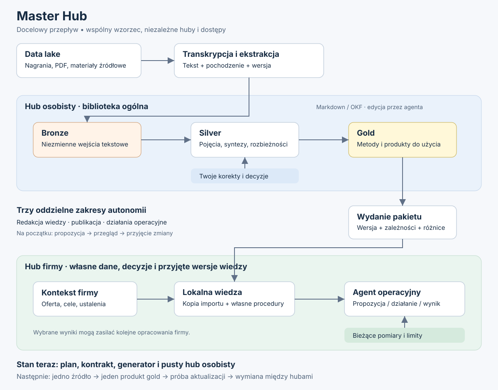
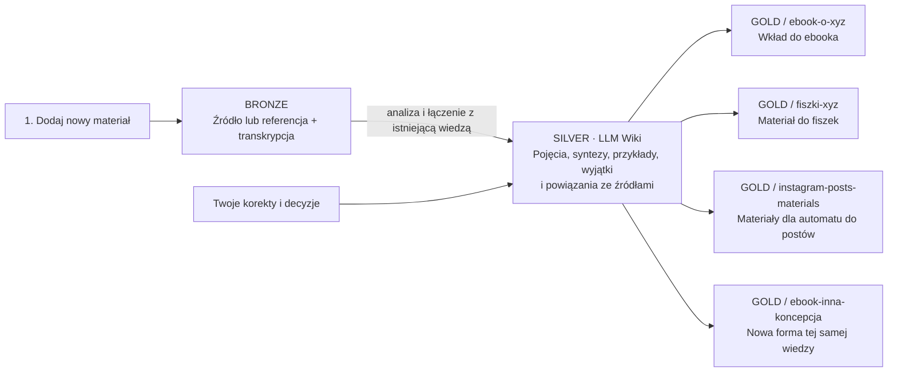

# Jedna baza wiedzy. Wiele zastosowań.

Dwa podstawowe działania: **„rozwiń moją wiedzę”** i **„wykorzystaj ją do konkretnego celu”**.

[Otwórz diagram SVG](architecture.svg).

Zachowujemy dwa uzupełniające się widoki:

- [Przepływ wiedzy](architecture.svg) — codzienna praca: źródła → wiki → różne rezultaty.
- [Architektura całego systemu](system-architecture.svg) — wcześniejszy diagram:
  data lake, hub osobisty, pakiety wiedzy, hub firmy i agent operacyjny.
  Ten szerszy widok opisuje możliwości docelowe, nie wymagania na start.

## 1. Dodaj materiał do bazy

Źródło — albo referencja do oryginału i jego transkrypcja — trafia do bronze.
Agent analizuje materiał i włącza go do silver: tworzy lub uzupełnia pojęcia,
łączy źródła, zachowuje przykłady, warunki stosowania i sprzeczności.

Silver jest rozwijaną wiki wiedzy wielokrotnego użycia. Nie jest zbiorem
niezależnych streszczeń. To tutaj koncentruje się codzienna praca nad wiedzą.

## 2. Poproś o konkretny wynik

Gdy potrzebujesz wkładu do ebooka, materiału do fiszek albo instrukcji dla
automatu, agent tworzy odpowiedni katalog gold i opracowanie w zadanej formie.

Przykładowe katalogi w `knowledge/20-gold/`:

- `ebook-o-xyz/` — wkład do ebooka z referencjami do materiałów źródłowych.
- `fiszki-xyz/` — materiał pytanie–odpowiedź do wygenerowania fiszek.
- `instagram-posts-materials/` — materiały, zasady i przykłady dla automatu do postów.
- `ebook-inna-koncepcja/` — nowe opracowanie tej samej wiedzy pod zmieniony pomysł.

Są to przykłady rezultatów; nie tworzymy pustych katalogów na zapas.
Gotowe posty są wynikiem działania automatu korzystającego z gold i bieżącego
zadania. Nie każdy wynik działania musi wracać do bazy wiedzy.

## Wartość warstwy pośredniej

Zmiana koncepcji oznacza nowe opracowanie gold z istniejącego silver.
Wykonana wcześniej analiza pozostaje dostępna dla kolejnych zastosowań.

Silver zachowuje szczegóły, powiązania i referencje, a nie tylko skrót.
Gdy nowy cel wymaga pominiętej informacji lub dokładnego cytatu, agent wraca
do odpowiedniego źródła w bronze. Nie zakładamy, że synteza wystarczy zawsze.
Własne hipotezy i luki w materiale pozostają jawne.

## Diagram do edycji

Każdy produkt gold powstaje na prośbę o konkretny wynik i zachowuje ścieżkę
do źródeł. Gotowość użytkowa, sprawdzenie treści i uprawnienie automatu do
działania są osobnymi sprawami.

## Organizacja repozytoriów

`master-hub` zawiera wzorzec, generator i dokumentację. Twoja biblioteka
ma osobne repozytorium `../personal-hub`. Kolejne huby również powstają
osobno. Schemat opisuje pracę wewnątrz każdego z nich.

Dokumenty wiedzy są w `knowledge/`, w warstwach `00-bronze`,
`10-silver` i `20-gold`. Kontrakt i konfiguracja leżą poza bundle'em OKF;
decyzje użytkownika są zapisywane osobno w `knowledge/90-decisions/`.
Reguły i metadane definiuje SCHEMA.md danego huba.

Obecnie treści opracowuje agent według kontraktu. Diagram nie oznacza
uruchomionego automatycznego procesu w tle. [Plan na teraz](plan.md)
zaczyna się od jednego materiału i jednego użytecznego wyniku.

## Podstawa wzorca

- Działająca implementacja w lokalnym `../founders-workbooks`.
- [LLM Wiki](https://gist.github.com/karpathy/442a6bf555914893e9891c11519de94f):
  przyrostowe utrzymywanie wiedzy przez agenta.
- [OKF](https://github.com/GoogleCloudPlatform/open-knowledge-format/blob/main/SPEC.md):
  format zapisu. Obecne szablony używają wersji 0.2.
