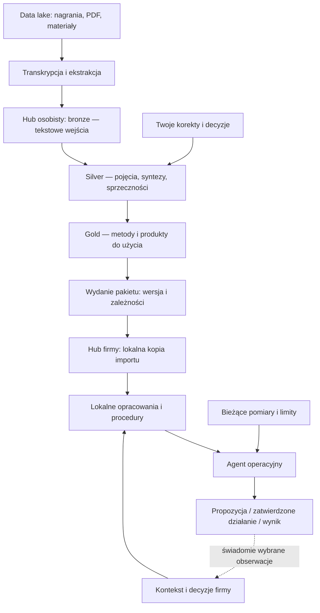

# Architektura Master Hub

Stan projektu: fundament i generator. Diagram pokazuje również elementy
docelowe; ich implementację rozdziela [plan](plan.md).

To mapa możliwości na przyszłość. Na początek korzystamy wyłącznie z huba
osobistego i przetwarzania materiału przez agenta. `master-hub` zawiera
wyłącznie wspólny wzorzec i narzędzia. Hub osobisty ma własny Git w sąsiednim
`personal-hub`. Każdy kolejny hub również powstaje poza master-hub,
w osobnym katalogu i osobnym repozytorium.


[Otwórz diagram jako samodzielny SVG](architecture.svg).

## Przepływ docelowy



## Granice systemu

**Warsztat osobisty:** biblioteka i narzędzia przetwarzania wielokrotnego
użycia. **Hub firmy:** jej kontekst, przyjęte wersje wiedzy, procedury oraz
historia decyzji. **Produkt SaaS:** aplikacja i usługi dla klientów.
Zależności produktu od warsztatu lub agentów operacyjnych opisujemy jawnie.
Możliwość rozdzielenia pozostaje otwarta; nie zakładamy sposobu sprzedaży.

Wspólny silnik oznacza wspólny kod i konwencje. Instancje wykonują pracę
z osobnymi dostępami i konfiguracją. Katalogi, tagi i `owner` w metadanych
nie są mechanizmem kontroli dostępu. Dane firmy nie wracają automatycznie
do biblioteki osobistej.

## Zawartość huba

```text
hub/
  AGENTS.md              punkt wejścia agenta
  SCHEMA.md              kontrakt przetwarzania
  hub.json               profil domeny i polityka pracy
  README.md              instrukcja dla człowieka
  knowledge/             granica bundle'a OKF 0.2
    index.md
    log.md
    00-bronze/           niezmienne wersje tekstowych wejść
    10-silver/           wiedza opracowana i połączona
    20-gold/             produkty przygotowane do użycia
    90-decisions/        korekty, decyzje, zakres zatwierdzeń
    imports/             przyszłe lokalne kopie pakietów
  .runtime/              przyszły stan wykonania, poza wersjonowaniem
```

Instrukcje agenta i konfiguracja leżą poza bundle'em, żeby nie mieszać
kontraktu wykonania z przetwarzanymi źródłami. Dla plików w `knowledge/`
korzeń odsyłaczy OKF to ten katalog. Przy pracy w Obsidianie preferujemy
zwykłe względne linki Markdown, które działają również w edytorach bez OKF.
Linki między treściami huba powinny pozostawać wewnątrz `knowledge/`.

## Co oznaczają warstwy

Bronze jest wejściem do tego procesu, choć transkrypcja powstała wcześniej.
Zachowuje wersję tekstu, pochodzenie i — jeśli dostępne — czas w nagraniu
lub stronę oryginału. Korekta transkrypcji tworzy nowe wejście.

Silver zawiera pojęcia, modele, warunki stosowania i porównania źródeł.
Gold zawiera produkty dla określonego odbiorcy: checklistę, procedurę,
metodę, scenariusz, specyfikację skilla. Skille i wykonywalne automatyzacje
są osobnymi produktami, wymagającymi sprawdzenia ich zachowania.

Gotowość użytkowa, weryfikacja treści i uprawnienie do wykonania działania
są niezależne. Status gold nie daje agentowi prawa do zmiany budżetu.

PARA to nawigacja po pracy, nie następny etap przetwarzania. Dodajemy strony
projektów, obszarów i zasobów, kiedy są potrzebne. Temat marketingu może być
zasobem, odpowiedzialność za marketing firmy obszarem, a kampania projektem.
Odsyłacze pozwalają używać tej samej wiedzy w kilku kontekstach.

## Silnik i wydania

Agent interpretuje, porównuje i proponuje treść. Kod identyfikuje wejścia,
waliduje strukturę, generuje indeksy i zapisuje historię. Integracje
operacyjne pobierają bieżące pomiary oraz wykonują dozwolone działania.
Surowych zdarzeń analitycznych nie zamieniamy wszystkich w notatki Markdown.

Wydanie przypina treść i zależności. Hub odbiorcy ma lokalną kopię; lokalne
adaptacje zapisuje osobno. Zmiana źródła uruchamia ocenę wpływu, a nie
bezwarunkowe przepisanie wszystkich dokumentów. Nowy materiał może ujawnić
zależności, których wcześniej nie zapisano: obok grafu potrzebne jest
wyszukanie powiązanych tematów. Ten mechanizm dodamy, kiedy zaczniemy
regularnie aktualizować wiedzę lub wymieniać ją między hubami.

## Podstawa projektu

- `../founders-workbooks`: odczytano kontrakt, skrypty i przykłady; linter
  sprawdził 495 dokumentów bez błędów i ostrzeżeń. Nie migrowano danych.
- [LLM Wiki](https://gist.github.com/karpathy/442a6bf555914893e9891c11519de94f):
  przyrostowo utrzymywana wiki i praca przez rozmowę z agentem.
- [OKF 0.2](https://github.com/GoogleCloudPlatform/open-knowledge-format/blob/main/SPEC.md):
  format plików i atrybucji; sprawdzony podczas projektowania 2026-09-08.
  Profil lokalny to osobny kontrakt. Przed implementacją walidatora trzeba
  przypiąć dokładną rewizję specyfikacji, bo `main` może się zmieniać.
