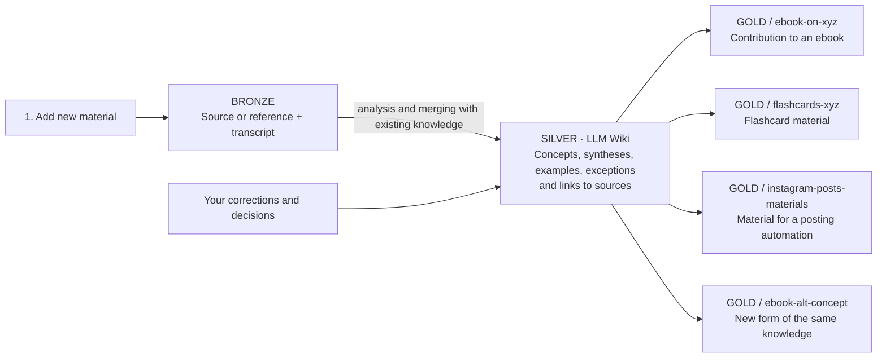

# One knowledge base. Many uses.

Three basic actions: **"extend my knowledge"**, **"ask it what it already
knows"**, and **"use it for a specific purpose"**. The diagrams on this
page focus on the two that flow through bronze/silver/gold — adding
material and requesting an output; the read-only Query action writes
nothing by default and is covered in [plan.md](plan.md) and the hub's
SCHEMA.md.

[Open the SVG diagram](architecture.svg).

We keep two complementary views:

- [Knowledge flow](architecture.svg) — everyday work: sources → wiki →
  various outputs.
- [Whole-system architecture](system-architecture.svg) — independent hubs
  and an agent using designated knowledge plus company context. No
  importing hubs, packages, or sync. This is an optional way for the
  agent to work, not an extra engine mechanism.

## 1. Add material to the base

A source — or a reference to the original plus its transcript — lands in
bronze. The agent analyzes the material and folds it into silver: it
creates or extends concepts, links sources, keeps examples, applicability
conditions, and contradictions.

Silver is a growing wiki of reusable knowledge. It isn't a collection of
independent summaries. This is where everyday knowledge work is
concentrated.

## 2. Ask for a specific result

When you need a contribution to an ebook, flashcard material, or
instructions for an automation, the agent creates the matching gold
directory and the output in the requested form.

Example directories under `knowledge/20-gold/`:

- `ebook-on-xyz/` — a contribution to an ebook with references to source
  material.
- `flashcards-xyz/` — question-answer material for generating flashcards.
- `instagram-posts-materials/` — material, rules, and examples for a
  posting automation.
- `ebook-alt-concept/` — a new piece of work from the same knowledge for a
  changed idea.

These are example outputs; we don't create empty directories
speculatively. Finished posts are the result of an automation using gold
and the current task. Not every action's output has to go back into the
knowledge base.

## The value of the middle layer

A concept change means a new gold output from the existing silver. Earlier
analysis stays available for future uses.

Silver preserves detail, connections, and references, not just a summary.
When a new goal needs information that was left out, or an exact quote,
the agent goes back to the relevant bronze source. We don't assume a
synthesis is always enough. Your own hypotheses and gaps in the material
stay explicit.

## Diagram to edit

Every gold output is created on request for a specific result and keeps a
path back to the sources. Being ready for use, checking content, and
authorizing an automation to act are separate matters.

## Repository organization

`master-hub` contains only the tool, templates, and documentation. It
doesn't store a hub registry. The user points to the target hub; it may
have its own repository or be part of a project. The diagram describes the
working pattern inside a hub, not existing installations.

Knowledge documents live in `knowledge/`, in the `00-bronze`, `10-silver`,
and `20-gold` layers. The contract and configuration sit outside the OKF
bundle; user decisions are recorded separately in `knowledge/90-decisions/`.
The target hub's own SCHEMA.md defines the rules and metadata.

On request, the agent can read theory in one hub and context in another.
It writes the result into the recipient's hub. Using an additional hub is
noted as plain text, without formal references between repositories. That
note isn't validated and doesn't replace the local sources required in
silver/gold. We don't copy libraries between hubs or propagate changes
automatically.

Right now, content is developed by the agent per the contract. The diagram
doesn't mean an automatic background process is running. [The plan for
now](plan.md) starts from one piece of material; you request a gold
output when you need it.

## Basis of the pattern

- [LLM Wiki](https://gist.github.com/karpathy/442a6bf555914893e9891c11519de94f):
  incremental knowledge maintenance by an agent.
- [OKF](https://github.com/GoogleCloudPlatform/open-knowledge-format/blob/main/SPEC.md):
  the storage format. The current templates use version 0.2.
