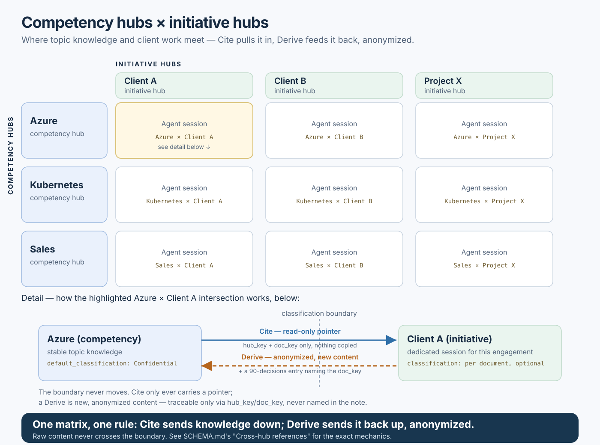

# Competency hubs × initiative hubs

The two hub axes introduced in 0.4.0 — `hub_category: "competency"`
(topic knowledge that cuts across clients: Azure, Kubernetes, sales) and
`hub_category: "initiative"` (client/project-specific work) — aren't just
a label. Put every competency hub on one axis of a matrix and every
initiative hub on the other, and each intersection is a real place where
work happens: a dedicated agent session, scoped to one initiative, that
can draw on one or more competency hubs while it works.

[Open the SVG diagram](cross-hub-architecture.svg).

This is a summary of 0.4.0 and 0.5.0 together, not a new mechanism of its
own — see [SCHEMA.md](../skills/create-knowledge-hub/assets/hub/SCHEMA.md)'s
"Stable identity" and "Cross-hub references" sections for the actual
contract, and [migration-0.4.0.md](migration-0.4.0.md) /
[migration-0.5.0.md](migration-0.5.0.md) for how to adopt it in an
existing hub.

## What crosses the boundary, and how

Nothing automatic connects a competency hub to an initiative hub. There's
no registry, no sync, no shared index — the only thing that ever crosses
between them is a deliberate `external_refs[]` entry an agent adds while
working in one specific document, and only in one of two shapes:

- **Cite** — a read-only pointer. The citing document names, in its own
  words, what the cited material is and why it matters; `hub_key` and
  `doc_key` are the actual link. Nothing from the target hub is copied
  in.
- **Derive** — new content. The agent writes something original — a
  generalized pattern, an anonymized estimate — locally, in the citing
  hub, under the same rules as any other material. The `note` explains
  what was generalized or removed, but never names the source hub or
  client; a `knowledge/90-decisions/` entry recording the derivation,
  naming the deriving document's own `doc_key`, is mandatory.

A closed classification system (`Public`/`Internal`/`Confidential`/
`Secret`) decides what's even eligible to cross this way.
`"Secret"` never crosses, in either direction, full stop. `"Confidential"`
material can be cited by pointer or generalized via Derive, but never
copied verbatim — and a `Confidential` note containing a suspiciously
specific figure gets flagged for review, same as any other candidate the
grounding report surfaces.

## Reading the matrix

The usual direction is **down**: an initiative session cites a
competency hub's stable patterns into a client deliverable — the
blue-green deployment pattern from the Azure hub, cited into a Client A
runbook, say. That's knowledge moving from something built once into
something built for one engagement.

The rarer, and more deliberate, direction is **up**: an initiative
session derives something generalized from client-specific work —
an anonymized estimate, a pattern that turned out to recur — and feeds
it back into a competency hub as new content, with the specifics
stripped and only a UUID trail back to where it came from. This is the
direction classification exists to guard: it's also the direction that
makes the whole system worth building, since it's how one client
engagement's hard-won pattern becomes reusable the next time a different
initiative needs it.

Either direction, the validator never opens the other hub. It checks
shape — that a `hub`/`doc` pair looks like a UUID, that `operation` and
`classification` are declared, that `"Secret"` never shows up and that a
Derive has its decision trail. Whether a `note` is actually abstract
enough, or an anonymization is actually adequate, stays a judgment call
for whoever's writing it and whoever reviews it — the same place every
other quality decision in this contract already lives.
